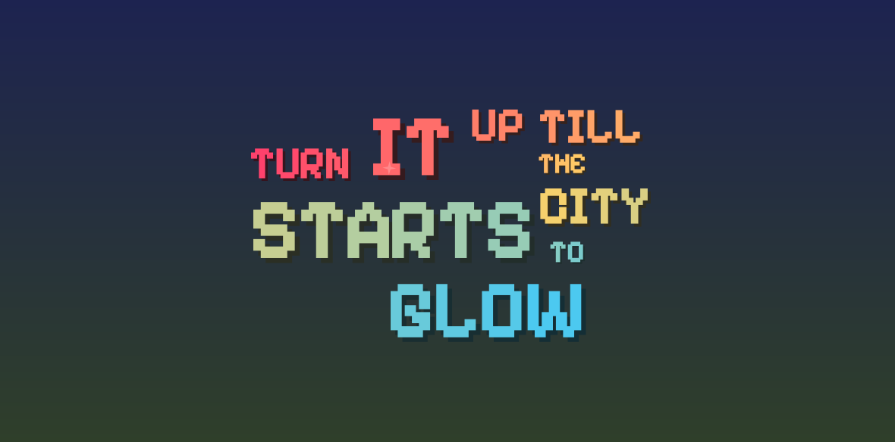

# LLyrics

[English](README.md) · **Español** · [Português](README.pt-BR.md)

Overlay de letras sincronizadas para Windows, hecho para jugar. Muestra la letra de la canción que suena encima de cualquier juego, con animaciones al estilo del mod de Minecraft *Show the Lyrics*.

## Descargar

**[⬇ Descargar la última versión](https://github.com/Luezion/LLyrics/releases/latest/download/LLyrics-windows.zip)** (Windows 10/11)

1. Extrae el zip en una carpeta tuya (ej.: `Documentos\LLyrics`). Evita `Archivos de programa`, si no la app no puede actualizarse sola.
2. Abre `LLyrics.exe`. La app queda en la bandeja, junto al reloj (ícono ♪). No hace falta Python.
3. Pon una canción.

Windows puede mostrar "Windows protegió tu PC" porque la app no tiene firma digital de pago. Haz clic en **Más información → Ejecutar de todas formas**.

Cuando sale una versión nueva, la app muestra una ventana para actualizar con un clic.

## Funciones

- Lee lo que suena en cualquier reproductor que aparezca en los controles multimedia de Windows (Spotify, YouTube y YouTube Music en el navegador, Apple Music, Deezer, VLC…)
- Busca la letra sincronizada en [lrclib.net](https://lrclib.net)
- Dibuja la letra en una ventana transparente, siempre encima, que **deja pasar los clics** al juego
- Widget "reproduciendo ahora" con portada, título, artista y barra de progreso; la portada puede ser un cuadrado, un círculo o un disco de vinilo girando, en tarjeta o como sticker estilo Instagram
- Disponible en **English, Español y Português (Brasil)**

### Estilos

- Entradas: máquina de escribir (al ritmo del canto), caída, subida, palabras, desvanecer, pop, onda
- Salidas: igual que la entrada, desvanecer, llevada por el viento
- Diseños: líneas, **pila** (palabras importantes grandes, pequeñas más chicas), primera palabra destacada (con o sin inclinación)
- Karaoke, cuenta regresiva instrumental, línea anterior y vista previa de la siguiente
- Color de la portada, paletas, arcoíris, color propio, **degradado de 2 o 3 colores**, arcoíris en movimiento
- Movimiento en reposo (temblar, onda, saltito, latir, flotar, balancear), destellos y modo fiesta
- Contorno, sombra, brillo y fondo; 12 fuentes libres (Google Fonts)
- Estilos listos, incluidos "Shake" y "Void Echoes", e importación de looks del sitio de la comunidad del mod con un código `STL-XXXXXX`

### Posición

- Fija (arrástrala con **Ctrl+Shift+K**) o **aleatoria en cada línea**
- Opción para **nunca aparecer en el centro de la pantalla**, para no tapar la mira en juegos de disparos

### Atajos

Atajos por defecto. Puedes cambiarlos en **Ajustes → Atajos**.

| Atajo | Acción |
|---|---|
| Ctrl+Shift+L | Mostrar/ocultar |
| Ctrl+Shift+K | Mover las ventanas |
| Ctrl+Shift+O | Ajustes |

## Comunidad

Comparte tus estilos y prueba los que hicieron otros jugadores, en **Ajustes → Comunidad**:

- **Copiar código**: convierte tu look actual en un código (`LLY1-…`) que puedes enviar a quien quieras. Se pega en *Estilo → Looks de la comunidad → Importar*.
- **Publicar en la comunidad**: abre un formulario de GitHub ya completado. Cuando se aprueba, el estilo aparece en la galería de todos.
- **Galería de la comunidad**: explora, mira la vista previa y aplica estilos con un clic.

Los looks del sitio del mod ([lyrics.remake.lol](https://lyrics.remake.lol/)) también se pueden importar (códigos `STL-…`), pero publicar allí solo es posible desde Minecraft con el mod.

## En juegos (Valorant y otros)

Pon el juego en **pantalla completa en ventana** (sin bordes). En pantalla completa exclusiva ningún overlay puede aparecer encima.

LLyrics no toca el juego: no lee memoria, no inyecta nada ni instala drivers. Son solo ventanas transparentes de Windows, como el overlay de Discord. Aun así, no hay aprobación oficial de ningún desarrollador de juegos para apps de terceros; úsala bajo tu responsabilidad.

## Ejecutar desde el código

1. Instala [Python 3.10+](https://www.python.org/downloads/) y marca **"Add python.exe to PATH"**
2. Descarga el código (**Code → Download ZIP**) y extráelo
3. Haz doble clic en `Iniciar.bat`

## Créditos

- Inspirado en el mod de Minecraft *Show the Lyrics* de FireStund. Looks de la comunidad: [lyrics.remake.lol](https://lyrics.remake.lol/). LLyrics se escribió desde cero; no se usó código del mod.
- Letras: [lrclib.net](https://lrclib.net)
- Fuentes: Google Fonts, licencia SIL OFL (`fonts/OFL-licenca-fontes.txt`)
