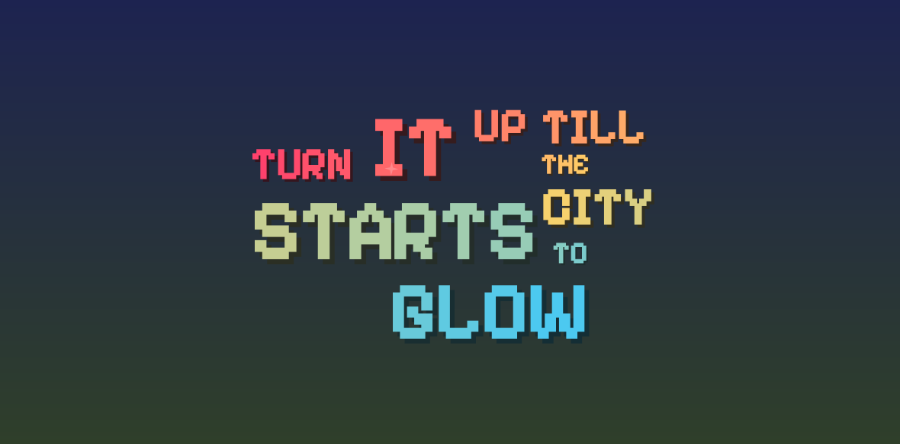

# LLyrics

Overlay de letras sincronizadas para Windows, feito para jogar. Mostra a letra da música que está tocando por cima de qualquer jogo, com animações no estilo do mod de Minecraft *Show the Lyrics*.

## O que ele faz

- Lê o que está tocando em qualquer player que aparece no controle de mídia do Windows (Spotify, YouTube e YouTube Music no navegador, Apple Music, Deezer, VLC…)
- Busca a letra sincronizada no [lrclib.net](https://lrclib.net)
- Desenha a letra numa janela transparente, sempre por cima, que **deixa o clique passar** para o jogo
- Widget "tocando agora" com capa, título, artista e barra de progresso

### Estilos

- Animações de entrada: máquina de escrever (no ritmo do canto), queda, subida, palavras, esmaecer, pop, onda
- Saídas: igual à entrada, esmaecer, levada pelo vento
- Layouts: linhas, **pilha** (palavras importantes grandes, pequenas menores), primeira palavra em destaque (com ou sem inclinação)
- Karaokê, contagem nos trechos instrumentais, linha anterior e prévia da próxima
- Cor da capa do álbum, paletas prontas, arco-íris, cor própria, **degradê de 2 ou 3 cores**, arco-íris correndo
- Movimento parado (tremer, onda, pulinho, pulsar, flutuar, balançar), brilhinhos e modo festa
- Contorno, sombra, brilho e fundo; 12 fontes livres (Google Fonts)
- Estilos prontos, incluindo "Shake" e "Void Echoes", e importação de looks do site da comunidade do mod pelo código `STL-XXXXXX`

### Posição

- Fixa (arraste com **Ctrl+Shift+K**) ou **aleatória a cada linha**
- Opção para **nunca aparecer no centro da tela**, para não cobrir a mira em jogos de tiro

## Como usar

1. Instale o [Python 3.10+](https://www.python.org/downloads/) e marque **"Add python.exe to PATH"**
2. Baixe este repositório (**Code → Download ZIP**) e extraia
3. Dê dois cliques em `Iniciar.bat`. Na primeira vez ele instala as dependências (1 a 2 minutos).
4. Toque uma música. O app fica na bandeja, perto do relógio (ícone ♪).

Para gerar um `.exe`: rode `Iniciar.bat` uma vez e depois `Gerar_exe.bat`. O app fica em `dist\LLyrics\LLyrics.exe`.

### Atalhos

| Atalho | Ação |
|---|---|
| Ctrl+Shift+L | Mostrar/esconder |
| Ctrl+Shift+K | Mover as janelas |
| Ctrl+Shift+O | Configurações |

## Em jogos (Valorant e outros)

Coloque o jogo em **janela em tela cheia** (borderless). No modo tela cheia exclusiva, nenhum overlay aparece por cima.

O LLyrics não mexe no jogo: não lê memória, não injeta nada e não instala driver. São só janelas transparentes do Windows, como o overlay do Discord. Ainda assim, não há aprovação oficial de nenhuma desenvolvedora de jogos para apps de terceiros; use por sua conta.

## Estrutura

| Arquivo | O que faz |
|---|---|
| `main.py` | Inicia o app, bandeja e atalhos |
| `media.py` | Lê o player pelo Windows (SMTC) |
| `lyrics.py` | Busca e lê letras LRC do lrclib |
| `render.py` | Desenho da letra, layouts, animações e widget |
| `overlay.py` | Janelas do overlay e posição |
| `settings_ui.py` | Janela de configurações |
| `looks.py` | Importa looks do site do mod |
| `config.py` | Opções e valores padrão |
| `winutil.py` | Clique atravessando a janela, sempre no topo, atalhos globais |

## Créditos

- Inspirado no mod *Show the Lyrics* (FireStund). Código escrito do zero; nenhum código do mod foi usado.
- Letras: [lrclib.net](https://lrclib.net)
- Fontes: Google Fonts, licença SIL OFL (`fonts/OFL-licenca-fontes.txt`)
