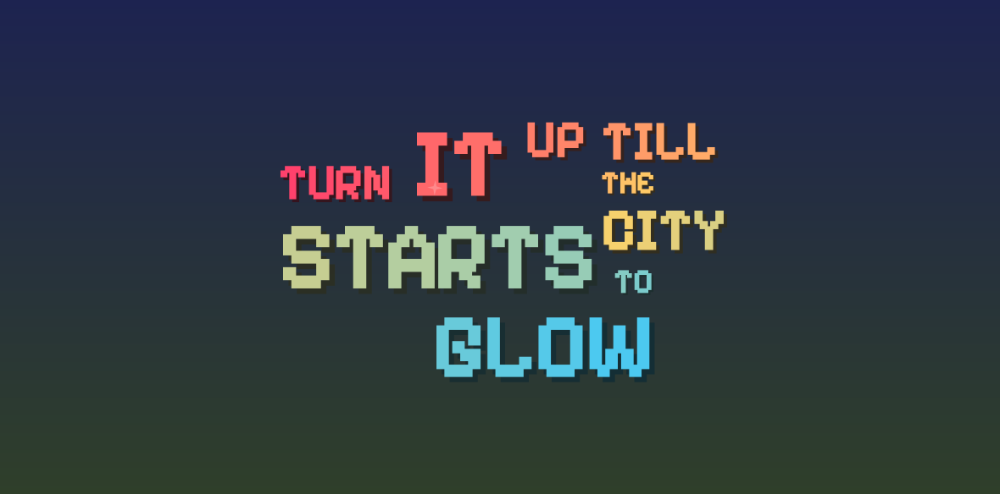

# LLyrics

[English](README.md) · [Español](README.es.md) · **Português**

Overlay de letras sincronizadas para Windows, feito para jogar. Mostra a letra da música que está tocando por cima de qualquer jogo, com animações no estilo do mod de Minecraft *Show the Lyrics*.

## O que ele faz

- Lê o que está tocando em qualquer player que aparece no controle de mídia do Windows (Spotify, YouTube e YouTube Music no navegador, Apple Music, Deezer, VLC…)
- Busca a letra sincronizada no [lrclib.net](https://lrclib.net)
- Desenha a letra numa janela transparente, sempre por cima, que **deixa o clique passar** para o jogo
- Widget "tocando agora" com capa, título, artista e barra de progresso; a capa pode ser quadrada, redonda ou um disco de vinil girando, em cartão ou como figurinha estilo Instagram
- Disponível em **English, Español e Português (Brasil)**

### Estilos

- Animações de entrada: máquina de escrever (no ritmo do canto), queda, subida, palavras, esmaecer, pop, onda
- Saídas: igual à entrada, esmaecer, levada pelo vento
- 11 layouts: linhas, **pilha**, primeira palavra em destaque (com ou sem inclinação), **arco**, **serpente**, **holofote** (uma palavra grande por vez), **espalhado**, **pôster**, **punchline** e **inclinada**
- Karaokê, contagem nos trechos instrumentais, linha anterior e prévia da próxima
- Cor da capa do álbum, paletas prontas, arco-íris, cor própria, **degradê de 2 ou 3 cores**, arco-íris correndo
- Movimento parado (tremer, onda, pulinho, pulsar, flutuar, balançar), brilhinhos e modo festa
- Contorno, sombra, brilho e fundo; 12 fontes livres (Google Fonts)
- **Meus estilos**: salve seus visuais no PC e troque entre eles com um clique (também pelo menu da bandeja)
- **Estilo para esta música**: um visual gerado a partir do ritmo, da letra, do gênero do artista ([MusicBrainz](https://musicbrainz.org)) e das cores da capa, uma vez ou a cada música
- Estilos prontos, incluindo "Shake" e "Void Echoes", e importação de looks do site da comunidade do mod pelo código `STL-XXXXXX`

### Posição

- Fixa (arraste com **Ctrl+Shift+K**) ou **aleatória a cada linha**
- Opção para **nunca aparecer no centro da tela**, para não cobrir a mira em jogos de tiro

## Baixar

**[⬇ Baixar a versão mais recente](https://github.com/Luezion/LLyrics/releases/latest/download/LLyrics-windows.zip)** (Windows 10/11)

1. Extraia o zip numa pasta sua (ex.: `Documentos\LLyrics`). Evite `Arquivos de Programas`, senão o app não consegue se atualizar sozinho.
2. Abra o `LLyrics.exe`. O app fica na bandeja, perto do relógio (ícone ♪).
3. Toque uma música.

O Windows pode mostrar "O Windows protegeu o computador", porque o app não tem assinatura digital paga. Clique em **Mais informações → Executar assim mesmo**.

Quando sair uma versão nova, o app mostra uma tela para atualizar com um clique.

### Rodar pelo código

1. Instale o [Python 3.10+](https://www.python.org/downloads/) e marque **"Add python.exe to PATH"**
2. Baixe o código (**Code → Download ZIP**) e extraia
3. Dê dois cliques em `Iniciar.bat`

### Atalhos

Atalhos padrão. Dá para trocar em **Configurações → Atalhos**.

| Atalho | Ação |
|---|---|
| Ctrl+Shift+L | Mostrar/esconder |
| Ctrl+Shift+K | Mover as janelas |
| Ctrl+Shift+O | Configurações |

## Comunidade

Compartilhe seus estilos e teste os que outros jogadores fizeram, em **Configurações → Comunidade**:

- **Copiar código**: transforma o seu visual atual num código (`LLY1-…`) que você pode mandar para qualquer pessoa. Ela cola em *Estilo → Looks da comunidade → Importar*.
- **Publicar na comunidade**: abre um formulário do GitHub já preenchido. Depois de aprovado, o estilo aparece na galeria de todo mundo.
- **Galeria da comunidade**: veja, confira a prévia e aplique estilos com um clique.

Os looks do site do mod ([lyrics.remake.lol](https://lyrics.remake.lol/)) também podem ser importados (códigos `STL-…`), mas publicar lá só é possível de dentro do Minecraft, com o mod.

## Em jogos (Valorant e outros)

Coloque o jogo em **janela em tela cheia** (borderless). No modo tela cheia exclusiva, nenhum overlay aparece por cima.

O LLyrics não mexe no jogo: não lê memória, não injeta nada e não instala driver. São só janelas transparentes do Windows, como o overlay do Discord. Ainda assim, não há aprovação oficial de nenhuma desenvolvedora de jogos para apps de terceiros; use por sua conta.

## Publicar uma versão nova

1. Escreva as novidades no topo do `CHANGELOG.md` (`## 1.3.0` e depois `### English`, `### Español` e `### Português`)
2. Mude o número em `version.py`
3. Envie para o `main`. O GitHub Actions gera o `.exe`, cria a Release e todo mundo recebe a tela de atualização no próprio idioma.

## Traduções

Todos os textos do app ficam em `i18n.py`. Para acrescentar um idioma, copie a coluna em inglês, traduza e adicione em `LANGUAGES`.

## Estrutura

| Arquivo | O que faz |
|---|---|
| `main.py` | Inicia o app, bandeja e atalhos |
| `media.py` | Lê o player pelo Windows (SMTC) |
| `lyrics.py` | Busca e lê letras LRC do lrclib |
| `render.py` | Desenho da letra, layouts, animações e widget |
| `overlay.py` | Janelas do overlay e posição |
| `settings_ui.py` | Janela de configurações |
| `looks.py` | Importa looks do site do mod |
| `autostyle.py` | Gera um estilo para a música que está tocando |
| `mystyles.py` | Estilos salvos no PC |
| `community.py` | Galeria da comunidade e compartilhamento |
| `lookcode.py` | Códigos de estilo (`LLY1-…`) |
| `config.py` | Opções e valores padrão |
| `updater.py` | Procura versão nova e atualiza o app |
| `i18n.py` | Traduções (English, Español, Português) |
| `hotkeys.py` | Atalhos globais configuráveis |
| `version.py` | Número da versão |
| `winutil.py` | Clique atravessando a janela, sempre no topo, atalhos globais |

## Créditos

- Inspirado no mod de Minecraft *Show the Lyrics*, de FireStund. Looks da comunidade: [lyrics.remake.lol](https://lyrics.remake.lol/). O LLyrics foi escrito do zero; nenhum código do mod foi usado.
- Letras: [lrclib.net](https://lrclib.net)
- Fontes: Google Fonts, licença SIL OFL (`fonts/OFL-licenca-fontes.txt`)
